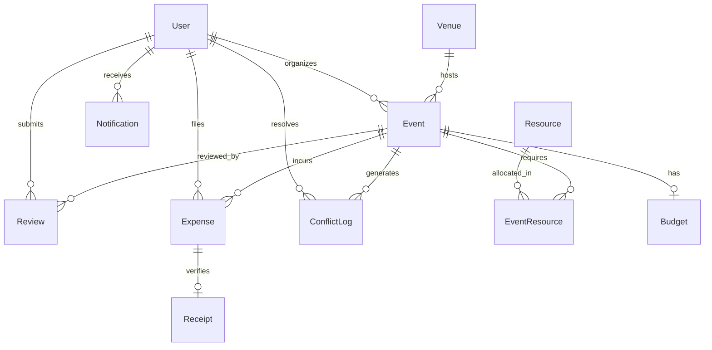

# ACM Resolve — Database Architecture & Entity Relationships

The database is built on **PostgreSQL** with **Prisma ORM**. It is structured for high-performance scheduling queries, conflict resolution auditing, financial reporting, and strict role-based data integrity.

---

## 1. Entity Relationship Overview

---

## 2. Table Specifications & Fields

### `User`
- **Primary Key**: `id` (CUID)
- **Fields**:
  - `name` (String)
  - `email` (String, unique) — enforces institutional domain restrictions
  - `role` (Role enum: `ADMIN`, `HOD`, `ORGANIZER`, `STUDENT`)
  - `department` (String, optional)
  - `avatar` (String, optional)
  - `createdAt`, `updatedAt` (DateTime)

### `Venue`
- **Primary Key**: `id` (CUID)
- **Fields**:
  - `name` (String, unique)
  - `building` (String)
  - `capacity` (Int)
  - `facilities` (String array)
  - `createdAt`, `updatedAt` (DateTime)

### `Resource`
- **Primary Key**: `id` (CUID)
- **Fields**:
  - `name` (String, unique)
  - `type` (String) — e.g., Audio, Visual, Furniture
  - `totalQuantity` (Int)
  - `createdAt`, `updatedAt` (DateTime)

### `Event`
- **Primary Key**: `id` (CUID)
- **Foreign Keys**:
  - `venueId` -> `Venue.id` (RESTRICT)
  - `organizerId` -> `User.id` (RESTRICT)
- **Fields**:
  - `title` (String), `description` (String, optional), `eventType` (String)
  - `status` (`DRAFT`, `PENDING`, `APPROVED`, `CHANGES_REQUESTED`, `REJECTED`)
  - `startTime` (DateTime), `endTime` (DateTime)
  - `expectedAttendance` (Int), `attendeesGroup` (String array)
  - `conflictSeverity` (`NONE`, `LOW`, `MEDIUM`, `HIGH`, `CRITICAL`)
  - `overrideReason` (String, optional)
  - `createdAt`, `updatedAt` (DateTime)
- **Indexes**:
  - `@@index([venueId, startTime, endTime])` — Critical for $O(\log n)$ live venue overlap checks.
  - `@@index([organizerId, startTime, endTime])` — Fast organizer double-booking lookups.
  - `@@index([startTime, endTime])` — Date-range calendar filtering.
  - `@@index([status])` — Review queue filtering.

### `EventResource`
- **Primary Key**: `id` (CUID)
- **Foreign Keys**: `eventId` -> `Event.id` (CASCADE), `resourceId` -> `Resource.id` (RESTRICT)
- **Fields**: `quantity` (Int), `createdAt` (DateTime)
- **Constraints**: `@@unique([eventId, resourceId])`

### `ConflictLog`
- **Primary Key**: `id` (CUID)
- **Foreign Keys**: `eventId` -> `Event.id` (CASCADE), `resolvedById` -> `User.id` (SET NULL)
- **Fields**:
  - `conflictType` (`VENUE_OVERLAP`, `ORGANIZER_DOUBLE_BOOKING`, `RESOURCE_CLASH`, `BUFFER_VIOLATION`, `STUDENT_GROUP_OVERLAP`)
  - `severity` (`LOW`, `MEDIUM`, `HIGH`, `CRITICAL`)
  - `score` (Float, 0–100)
  - `details` (JSON) — snapshot of conflicting event IDs, overlap minutes, gap minutes
  - `resolvedAt` (DateTime, optional)
  - `createdAt`, `updatedAt` (DateTime)

### `Review`
- **Primary Key**: `id` (CUID)
- **Foreign Keys**: `eventId` -> `Event.id` (CASCADE), `reviewerId` -> `User.id` (RESTRICT)
- **Fields**:
  - `decision` (`APPROVED`, `REJECTED`, `CHANGES_REQUESTED`)
  - `comment` (String, optional)
  - `changesRequested` (String array)
  - `createdAt` (DateTime)

### `Budget`
- **Primary Key**: `id` (CUID)
- **Foreign Keys**: `eventId` -> `Event.id` (CASCADE, unique 1-to-1)
- **Fields**:
  - `allocated` (Float)
  - `notes` (String, optional)
  - `createdAt`, `updatedAt` (DateTime)

### `Expense`
- **Primary Key**: `id` (CUID)
- **Foreign Keys**:
  - `eventId` -> `Event.id` (CASCADE)
  - `createdById` -> `User.id` (RESTRICT)
  - `receiptId` -> `Receipt.id` (SET NULL, unique optional)
- **Fields**:
  - `title` (String), `amount` (Float)
  - `category` (`VENUE`, `EQUIPMENT`, `CATERING`, `MARKETING`, `TRAVEL`, `PRIZES`, `MISCELLANEOUS`)
  - `status` (`PENDING`, `APPROVED`, `REJECTED`)
  - `createdAt`, `updatedAt` (DateTime)
- **Indexes**:
  - `@@index([eventId])`
  - `@@index([category])`
  - `@@index([createdAt])`

### `Receipt`
- **Primary Key**: `id` (CUID)
- **Fields**:
  - `fileUrl` (String), `fileName` (String), `fileSize` (Int), `mimeType` (String)
  - `storageProvider` (String) — `cloudinary` or `s3`
  - `uploadedAt` (DateTime)

### `Notification`
- **Primary Key**: `id` (CUID)
- **Foreign Keys**: `userId` -> `User.id` (CASCADE)
- **Fields**: `title`, `message`, `type`, `read` (Boolean), `createdAt`
